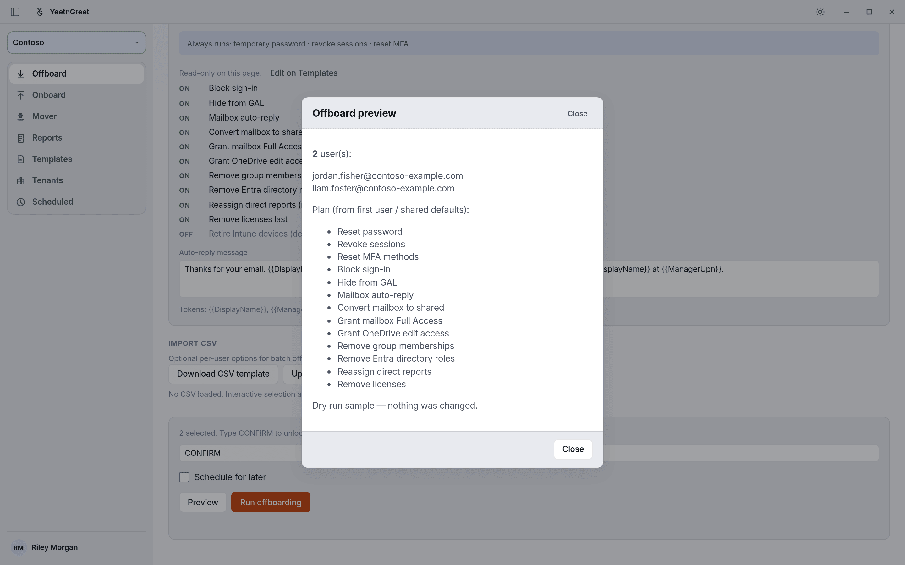

# First run

After [install](install.md), walk through a low-risk path: pick a tenant, confirm it's the right one, then preview before anything runs.

## Checklist

1. **Launch** YeetnGreet on your PC
2. **Sign in** to your Microsoft 365 tenant on **Tenants**. Admin consent must already be granted in that tenant. See [Admin permissions and consent](permissions.md)
3. Confirm the tenant name and domain are the ones you expect
4. Open **Offboard** or **Onboard** and click **Preview** before you confirm
5. Optionally save a [template](../jobs/templates.md) if this tenant has a standard checklist

{ width="720" }
*Preview lists every planned action and changes nothing.*

!!! tip "Confirm the tenant"
    Say the organization name out loud before you confirm. Running a job in the wrong tenant is expensive. The tenant picker at the top of the left rail shows which tenant every job runs in. See [Multi-tenant](../tenants/multi-tenant.md).

## Suggested first job

| Goal | Path |
| --- | --- |
| Practice offboard flow | [Offboard](../jobs/offboard.md) with a test user or dry-run style preview |
| Practice onboard flow | [Onboard](../jobs/onboard.md) creating a clearly labeled test account |
| See license value | [License audit](../reports/license-audit.md) on a tenant you know well |

## Where local files live

Working files (templates, local logs, and related data) stay on your PC, typically under AppData or Documents — unless you choose another location. They are **not** uploaded to YeetnGreet’s cloud as job payloads.

## Next

- [Offboard how-to](../jobs/offboard.md)
- [Onboard how-to](../jobs/onboard.md)
- [Pricing and licensing](../pricing-and-licensing.md)
