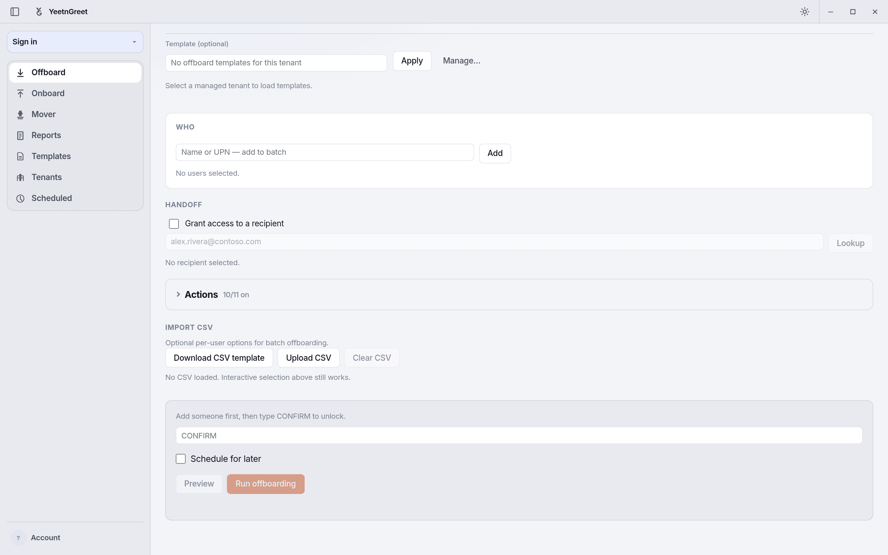
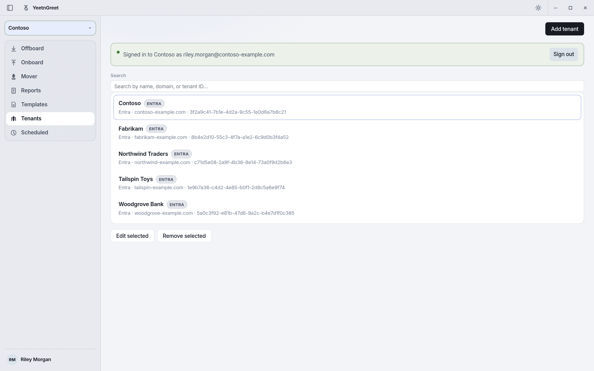

# Install

YeetnGreet is a **Windows** app that uses **Microsoft Edge WebView2** for the UI. Each technician installs it on their own Windows PC with **`YeetnGreet-Setup.exe`**.

## 1. Get the setup file

Public Windows downloads are **not available yet**. When your access is ready:

1. [Join the waitlist](https://yeetngreet.app/pricing.html) on the pricing page
2. Run **`YeetnGreet-Setup.exe`** on each technician PC that will use YeetnGreet

!!! note "Coming with the release"
    The setup file ships with the release for licensed users. Waitlist members get access through the preregister path first. Download links will appear here when the public release ships.

## 2. Install

1. Double-click **`YeetnGreet-Setup.exe`**
2. Allow Windows SmartScreen / firewall prompts if your environment shows them
3. The setup installs for the **current user** — no admin rights required
4. Files go under `%LOCALAPPDATA%\Programs\YeetnGreet`
5. Windows gets a **Start menu** shortcut and an **uninstall** entry in Settings
6. You can delete the setup file after install

## 3. WebView2

Most Windows 10/11 machines already have the **Evergreen WebView2 Runtime**. If the app cannot start the UI:

1. Install (or repair) the [Microsoft Edge WebView2 Runtime](https://developer.microsoft.com/microsoft-edge/webview2/)
2. Open YeetnGreet again from the Start menu

## 4. First launch

1. Open **YeetnGreet** from the Start menu
2. You should see the YeetnGreet shell ready for tenant sign-in

{ width="720" }
*First launch: the app opens on Offboard. Sign in to your YeetnGreet profile from the account menu, then pick a tenant.*

## 5. Tenant sign-in

Sign in with an account that can administer the **Microsoft 365 tenant** you are working in. Graph calls leave from **this PC** to Microsoft — not through YeetnGreet’s vendor cloud.

!!! note "Admin consent first"
    Each tenant needs an admin to grant consent for YeetnGreet's Microsoft Graph and Exchange Online permissions before the first job. See [Admin permissions and consent](permissions.md) for the full list.

{ width="720" }
*After Microsoft sign-in on this PC, the Tenants page confirms which tenant and account you are signed in to.*

!!! important "What our cloud sees"
    License and billing metadata for your YeetnGreet account only. Not mail, files, or directory content used during jobs.

## Updates

YeetnGreet updates itself **in place**. You do not need to keep `YeetnGreet-Setup.exe` on disk or re-run setup for routine updates.

## Uninstall

To remove YeetnGreet from a PC:

1. Open **Windows Settings → Apps**, or use the **Uninstall YeetnGreet** Start menu shortcut
2. Follow the uninstall prompts
3. Optionally remove local logs if you no longer need them (typically under AppData)

## Next

Continue with [First run](first-run.md) to complete a safe preview job.
