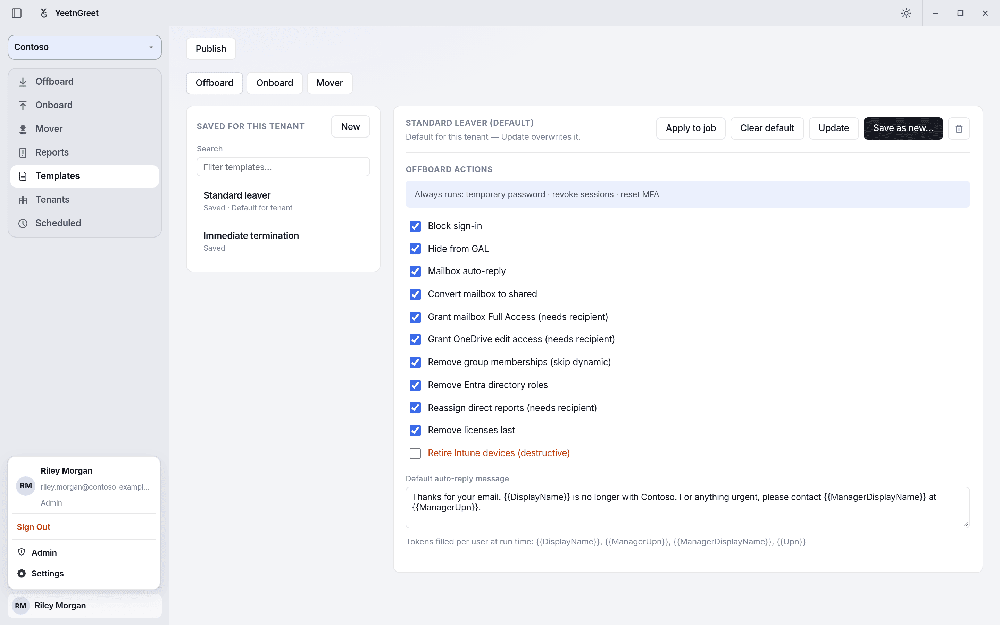
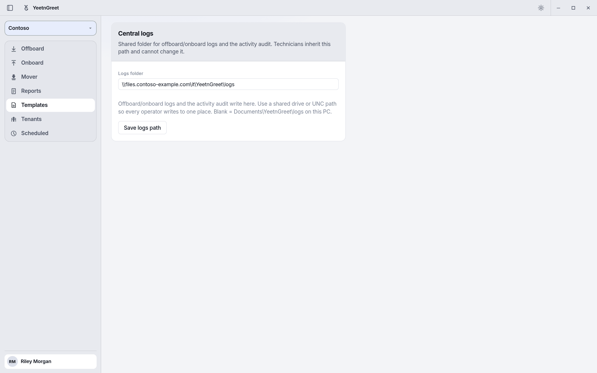

# Roles: admin and tech

YeetnGreet has two roles for the people who use the app: **Admin** and **Tech**. Your role decides what you can change in YeetnGreet itself, such as templates, the tenant list, and where logs go.

!!! info "Roles are not Microsoft 365 admin permissions"
    This page covers YeetnGreet's own roles. They don't give anyone rights in a Microsoft 365 tenant. What a job can change in a tenant still depends on the admin consent and the Entra roles described in [Admin permissions and consent](permissions.md). A Tech still signs in to the tenant with an account that has the right Microsoft roles.

## Two different sign-ins

| Sign-in | Where | What it's for |
| --- | --- | --- |
| **YeetnGreet profile** | Account menu at the bottom of the left rail, or **Settings** → **Profile** | Your plan, your role, and your company's shared tenants and templates. Uses only `User.Read` on your own work account. |
| **Tenant sign-in** | **Tenants** page | Running jobs and reports in a Microsoft 365 tenant. |

Your role comes from your YeetnGreet profile, so sign in to the profile to get it.

## What each role can do

| Task | Admin | Tech |
| --- | :---: | :---: |
| Run offboard, onboard, and mover jobs | Yes | Yes, with an applied template |
| Schedule jobs | Yes | Yes, with an applied template |
| Run license reports and use What-if | Yes | Yes |
| Review templates and apply them to jobs | Yes | Yes |
| Create, update, delete, and publish templates | Yes | No |
| Set or clear a tenant's default template | Yes | No |
| Add, edit, or remove tenants | Yes | No |
| Set the central logs folder on the **Admin** page | Yes | No |

A Tech's jobs always use the actions from the template they applied. The app checks this again when the job runs, so actions can't be changed for a single job.

## Who gets which role

- **The license owner is the admin.** The first person to sign in to the YeetnGreet profile with the email on your license becomes an admin.
- **Coworkers join as Tech.** When someone else at your company signs in to the YeetnGreet profile with their work account, they join your YeetnGreet org as a Tech. Their account must be on your company's email domain, and the org must have room for another operator.
- **Changing roles.** To make another person an admin, or to remove someone, [contact support](../support.md).

On the **Free** plan there are no roles. Whoever uses the app on that PC can do everything, and templates are optional.

## Set up roles

1. **Owner signs in first.** On the PC of the person whose email is on the license, open the account menu and click **Sign in**. Use the license email. The account menu then shows **Admin** under the name.
2. **Add the tenants.** On **Tenants**, add each tenant your team works in. Admins can change this list.
3. **Build and publish templates.** On **Templates**, create the offboard and onboard templates for each tenant, then click **Publish** on each one. Optionally click **Set as default**. See [Templates](../jobs/templates.md).
4. **Set the logs folder (optional).** Open the account menu, click **Admin**, and enter a shared folder or UNC path under **Central logs**. Click **Save logs path**. Techs write their logs there and can't change it.
5. **Techs sign in.** Each Tech installs YeetnGreet, opens the account menu, and signs in to the YeetnGreet profile with their work account. Their PC pulls your tenants and published templates automatically.

{ width="720" }
*An admin's account menu. The role shows under the name, and the Admin page is one click away.*

{ width="720" }
*Only admins see the Admin page. Set one logs folder for the whole team.*

## What a Tech sees

- **Templates** is review-only. A note at the top says templates come from your admin. The editor is greyed out, and only **Apply to job** is available.
- **Offboard**, **Onboard**, and **Mover** show **Template (required)**. **Preview** and **Run** stay locked until a template is applied.
- **Tenants** lists your company's tenants, but adding or editing them is locked.
- The account menu has no **Admin** entry.

{ width="720" }
*A Tech can review a template and apply it, but not change it.*

{ width="720" }
*Techs apply a template before they can preview or run an offboard.*

## Gotchas

- **Sign in to the YeetnGreet profile first.** On paid plans, tenant names stay hidden until you're signed in to the profile.
- **Owner signs in first.** Have the license owner sign in before anyone else so the owner becomes the admin.
- **Techs need a published template.** If a template exists only on the admin's PC, the Tech gets "Template not found locally." Publish it, then the Tech can open **Settings** → **Profile** → **Refresh company catalog**.
- **Role isn't access to the tenant.** An admin in YeetnGreet still needs the right Microsoft 365 roles to sign in to a tenant and run a job.

## Related

- [Admin permissions and consent](permissions.md)
- [Templates](../jobs/templates.md)
- [Multi-tenant](../tenants/multi-tenant.md)
- [Pricing and licensing](../pricing-and-licensing.md)
