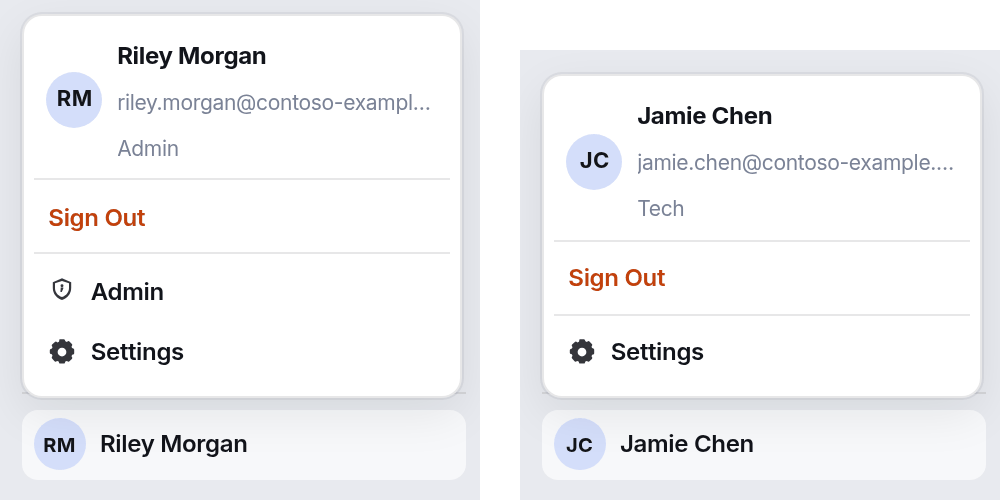
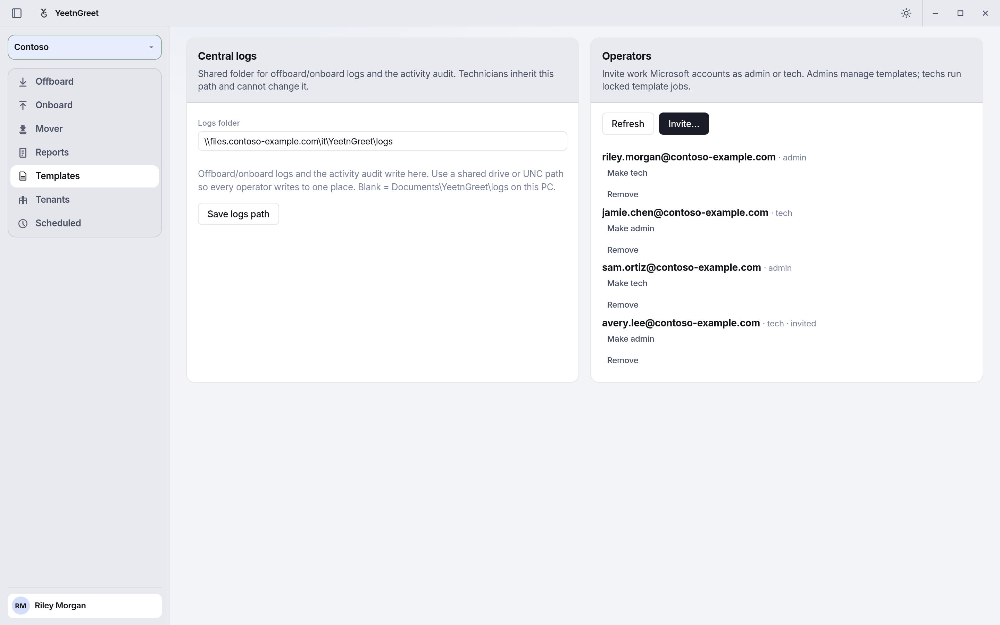
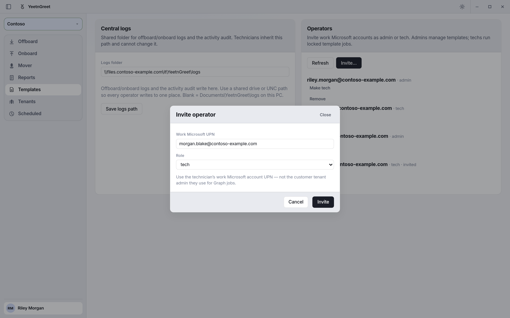
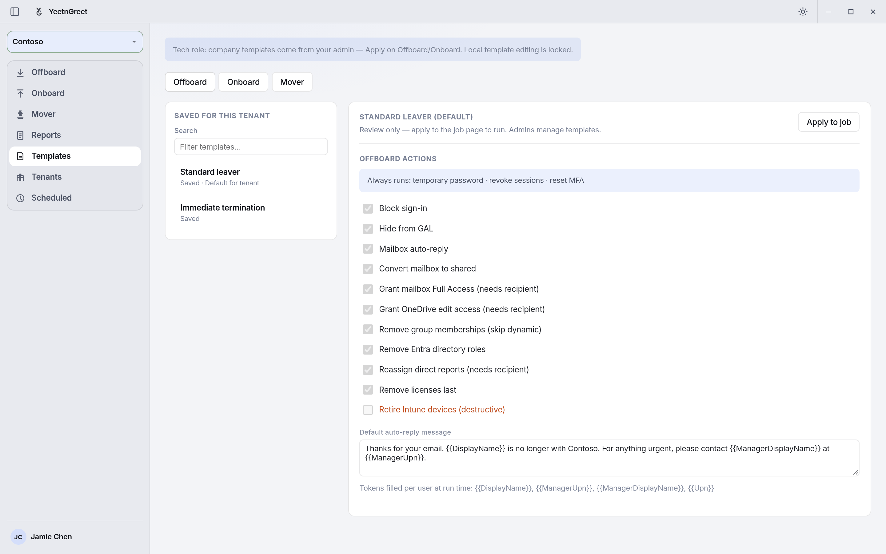
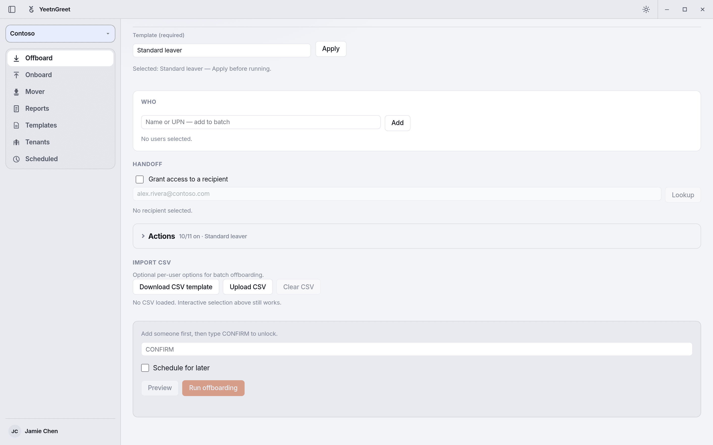

# Roles: admin and tech

YeetnGreet has two roles for the people who use the app: **Admin** and **Tech**. Your role decides what you can change in YeetnGreet itself, such as templates, the tenant list, and where logs go.

!!! info "Roles are not Microsoft 365 admin permissions"
    This page covers YeetnGreet's own roles. They don't give anyone rights in a Microsoft 365 tenant. What a job can change in a tenant still depends on the admin consent and the Entra roles described in [Admin permissions and consent](permissions.md). A Tech still signs in to the tenant with an account that has the right Microsoft roles.

## Two different sign-ins

| Sign-in | Where | What it's for |
| --- | --- | --- |
| **YeetnGreet profile** | Account menu at the bottom of the left rail, or **Settings** → **Profile** | Your plan, your role, and your company's shared tenants and templates. Uses only `User.Read` on your own work account. |
| **Tenant sign-in** | **Tenants** page | Running jobs and reports in a Microsoft 365 tenant. |

Your role comes from your YeetnGreet profile, so sign in to the profile to get it.

## What each role can do

| Task | Admin | Tech |
| --- | :---: | :---: |
| Run offboard, onboard, and mover jobs | Yes | Yes, with an applied template |
| Schedule jobs | Yes | Yes, with an applied template |
| Run license reports and use What-if | Yes | Yes |
| Review templates and apply them to jobs | Yes | Yes |
| Create, update, delete, and publish templates | Yes | No |
| Set or clear a tenant's default templates | Yes | No |
| Add, edit, or remove tenants | Yes | No |
| Invite operators and change their role on the **Admin** page | Yes | No |
| Set the central logs folder on the **Admin** page | Yes | No |

Your role shows under your name in the account menu: **Admin** or **Tech**. Click **Sign Out** in the same menu to sign out of your YeetnGreet profile.

{ width="560" }
*Left: an admin's account menu, with the Admin page one click away. Right: a Tech's menu, with no Admin entry.*

## Who gets which role

- **The license owner is the first admin.** Only the person who signs in with the email on your license becomes an admin automatically. Being the first person to sign in doesn't make you an admin.
- **Everyone else joins as Tech.** A coworker who signs in to the YeetnGreet profile with a work account on your company's email domain joins as a Tech, as long as the org has room for another licensed user.
- **Admins invite operators and set roles.** An admin can invite people and promote or demote them on the **Admin** page. See [Invite operators and change roles](#invite-operators-and-change-roles).

On the **Free** plan there are no roles. Whoever uses the app on that PC can do everything, and templates are optional.

## Set up roles

1. **Owner signs in first.** On the PC of the person whose email is on the license, open the account menu and click **Sign in**. Use the license email. The account menu then shows **Admin** under the name.
2. **Add the tenants.** On **Tenants**, add each tenant your team works in. Admins can change this list.
3. **Build and publish templates.** On **Templates**, create the offboard, onboard, and mover templates for each tenant, then click **Publish** on each one. Optionally click **Set as default**. See [Templates](../jobs/templates.md).
4. **Invite your team (optional).** Open the account menu, click **Admin**, and invite each Tech under **Operators**. See below.
5. **Set the logs folder (optional).** On the **Admin** page, enter a shared folder or UNC path under **Central logs**, then click **Save logs path**. Techs write their logs there and can't change it.
6. **Techs sign in.** Each Tech installs YeetnGreet, opens the account menu, and signs in to the YeetnGreet profile with their work account. Their PC pulls your tenants and published templates automatically.

## Invite operators and change roles

Open the account menu and click **Admin**. The **Operators** card lists everyone who can use YeetnGreet for your company, with their role. Invited people who haven't signed in yet are marked **invited**.

| To | Do this |
| --- | --- |
| Invite someone | Click **Invite…**, enter their work Microsoft UPN, pick **tech** or **admin**, and click **Invite**. They get the role the first time they sign in to the YeetnGreet profile. |
| Make a Tech an admin | Click **Make admin** next to their name. |
| Make an admin a Tech | Click **Make tech** next to their name. |
| Remove someone | Click **Remove** next to their name. This also revokes their access to your YeetnGreet org. To let them back in, invite them again. |
| See the latest list | Click **Refresh**. |

Your org always keeps at least one admin, so **Make tech** and **Remove** are greyed out for the last admin. Invites count toward your plan's licensed users. When the org is full, the invite is refused until you remove someone or move to a larger plan.

{ width="720" }
*The Admin page. Operators lists your admins and Techs; one invite is waiting for its first sign-in.*

{ width="720" }
*Invite with the person's own work account, not the account they use to sign in to a customer tenant.*

## The Tech template lock

On paid plans, a Tech's jobs always follow a company template. A Tech fills in who the job is for. The template decides what the job does.

| Job | A Tech can fill in | Locked to the template |
| --- | --- | --- |
| **Offboard** | The people leaving, the handoff recipient, and the manager | Every action and the auto-reply text |
| **Onboard** | Name, UPN, and manager, plus any job, organization, or contact field the template leaves blank | The actions, the groups, the licenses, and every field the template sets, such as a department |
| **Mover** | The person who is moving, plus any new-position field the template leaves blank | The actions, the groups, the licenses, and every new-position field the template sets |

- **A template is required.** Offboard, Onboard, and Mover show **Template (required)**. **Preview** and **Run** stay locked until a template is applied.
- **Fields the template sets are locked.** When a template sets a field, such as an onboard department of Sales, the job uses that value and a Tech can't change it. Hover over the field to see **Set by company template**.
- **Fields the template leaves blank are yours.** A Tech can fill in a field the template doesn't set, such as a job title, and the job keeps that value.
- **Required fields must be filled.** If the template marks a field as required, the job won't run until it's filled in.
- **Groups and licenses come only from the template.** A Tech can't add groups or licenses, or remove the ones the template adds.
- **The lock is checked again when the job runs.** YeetnGreet applies the template's actions, groups, and licenses again when it runs the job, so changes made outside the job page don't carry through. Scheduled jobs are checked when you schedule them.
- **Techs can't change templates.** They can review a template on **Templates** and apply it to a job. Only admins create, edit, publish, or set defaults.

{ width="720" }
*A Tech fills in who the new hire is, including the job title this template leaves blank. The department, actions, groups, and license come from the template.*

{ width="720" }
*A Tech can review a template and apply it, but not change it.*

{ width="720" }
*Techs apply a template before they can preview or run an offboard.*

## What a Tech sees

- **Templates** is review-only. A note at the top says templates come from your admin. The editor is greyed out, and only **Apply to job** is available.
- **Offboard**, **Onboard**, and **Mover** show **Template (required)**, and the locked settings are greyed out.
- **Tenants** lists your company's tenants, but adding or editing them is locked.
- The account menu shows **Tech** under your name and has no **Admin** entry.

## Gotchas

- **Sign in to the YeetnGreet profile first.** On paid plans, tenant names stay hidden until you're signed in to the profile.
- **Owner signs in first.** Only the license email becomes an admin on its own. Until the owner signs in, nobody can invite operators or change roles.
- **Invite the work account.** Use the person's own work Microsoft account, not a customer tenant admin account.
- **Techs need a published template.** If a template exists only on the admin's PC, the Tech gets "Template not found locally." Publish it, then the Tech can open **Settings** → **Profile** → **Refresh company catalog**.
- **Role changes apply at the next sign-in.** After you change someone's role, they see it the next time they sign in to the YeetnGreet profile.
- **Role isn't access to the tenant.** An admin in YeetnGreet still needs the right Microsoft 365 roles to sign in to a tenant and run a job.

## Related

- [Admin permissions and consent](permissions.md)
- [Templates](../jobs/templates.md)
- [Multi-tenant](../tenants/multi-tenant.md)
- [Pricing and licensing](../pricing-and-licensing.md)
