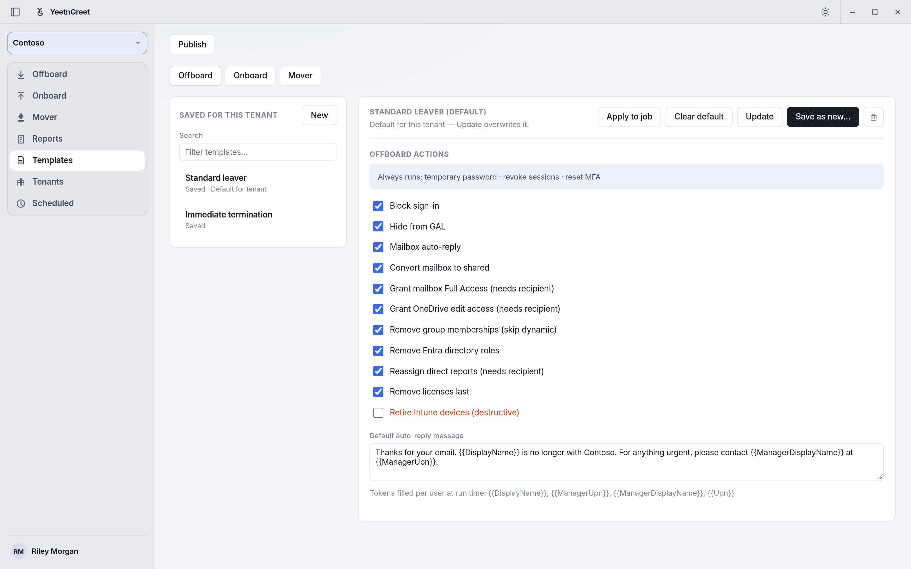
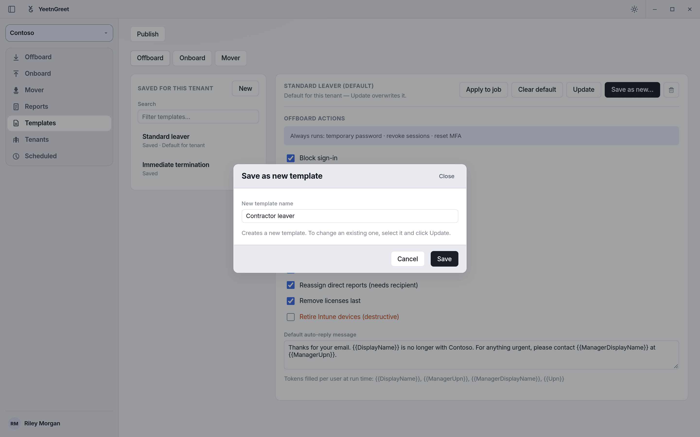
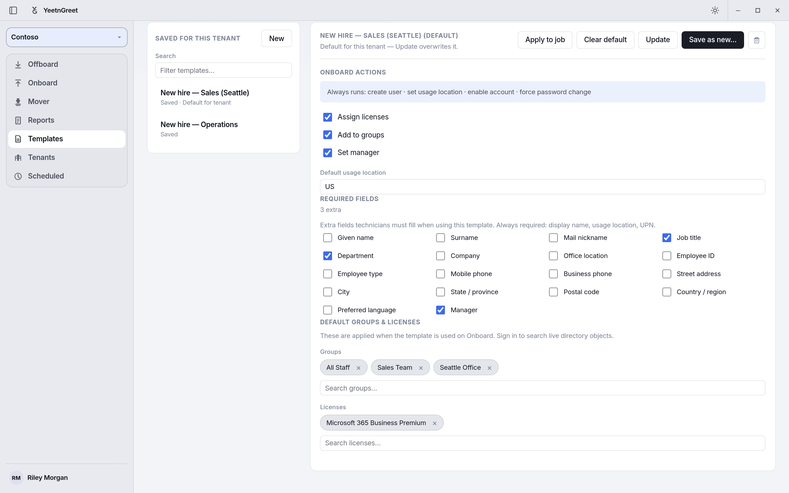

# Templates

A template is a saved set of job settings for one tenant. You pick it on **Offboard**, **Onboard**, or **Mover**, click **Apply**, and the job uses those settings. Templates keep every technician on the same checklist for that tenant.

There are three kinds:

| Kind | What it sets |
| --- | --- |
| **Offboard** | Which offboard actions run, plus the default auto-reply message |
| **Onboard** | Optional onboard steps, default usage location, extra required fields, default groups and licenses |
| **Mover** | Mover steps, the default new position (job title, department, company, office, employee type), and groups and licenses to add |

Templates belong to the tenant selected in the left rail. A template you save for Contoso doesn't show up for Fabrikam.

!!! note "Who can edit templates"
    Admins create, edit, delete, and publish templates. Techs can open a template to review it and apply it to a job, but they can't change it. See [Roles: admin and tech](../getting-started/roles.md).

## Before you start

- Select the tenant in the left rail.
- Sign in to the tenant on **Tenants** if you want to search live groups and licenses for an onboard or mover template. Actions and text fields work without signing in.
- On a paid plan, sign in to your YeetnGreet profile from the account menu so you can publish templates for the rest of your team.

## Create an offboard template

1. Open **Templates** and click **Offboard**.
2. Click **New**. The editor resets to the default actions.
3. Tick the actions this tenant's leavers should get. These always run and can't be turned off: temporary password, revoke sessions, and reset MFA.
4. Write the **Default auto-reply message**. You can use these tokens, which are filled in for each person at run time: `{{DisplayName}}`, `{{ManagerUpn}}`, `{{ManagerDisplayName}}`, `{{Upn}}`.
5. Click **Save as new…**, type a name, and click **Save**.

{ width="720" }
*An offboard template: tick the actions, write the auto-reply, then save.*

{ width="720" }
*Save as new always creates a new template. To change one, select it and click Update.*

Offboard actions you can turn on or off:

| Action | On by default |
| --- | --- |
| Block sign-in | Yes |
| Hide from GAL | Yes |
| Mailbox auto-reply | Yes |
| Convert mailbox to shared | Yes |
| Grant mailbox Full Access (needs recipient) | Yes |
| Grant OneDrive edit access (needs recipient) | Yes |
| Remove group memberships (skip dynamic) | Yes |
| Remove Entra directory roles | Yes |
| Reassign direct reports (needs recipient) | Yes |
| Remove licenses last | Yes |
| Retire Intune devices (destructive) | No |

Actions marked "needs recipient" only run when the technician picks a handoff recipient on the Offboard page. **Retire Intune devices** also needs admin consent in the tenant. See [Admin permissions](../getting-started/permissions.md).

## Create an onboard template

1. Open **Templates** and click **Onboard**, then **New**.
2. Choose the optional steps: **Assign licenses**, **Add to groups**, **Set manager**. These always run: create user, set usage location, enable account, and force a password change at next sign-in.
3. Set the **Default usage location** (two letters, for example `US`).
4. Under **Required fields**, tick any extra fields the technician must fill in. Display name, usage location, and UPN are always required. Ticking **Manager** also turns on **Set manager**.
5. Under **Default groups & licenses**, search for and add the groups and licenses every new hire should get.
6. Click **Save as new…**, name it (for example "New hire — Sales"), and click **Save**.

{ width="720" }
*An onboard template with three required fields, three default groups, and one license.*

## Create a mover template

Mover templates describe the person's new role.

1. Open **Templates** and click **Mover**, then **New**.
2. Choose the steps: **Update job profile**, **Set manager**, **Add to groups**, **Assign licenses**.
3. Fill in the **Default new position** fields you want preset.
4. Add the groups and licenses the new role needs.
5. Click **Save as new…** and name it.

## Use a template on a job

1. Open **Offboard**, **Onboard**, or **Mover**.
2. In **Template**, pick the template and click **Apply**.
3. Add the people and finish the job as usual. On Offboard, the **Actions** list is read-only and shows what the template turns on.

You can also select a template on **Templates** and click **Apply to job**. That opens the matching job page with the template applied.

When the label reads **Template (required)**, you have to apply a template before **Preview** and **Run** unlock.

## Change or delete a template

| To | Do this |
| --- | --- |
| Change it | Select it, edit, click **Update**, and confirm. This overwrites the saved template. |
| Copy it | Select it, edit, click **Save as new…**, and give it a new name. |
| Delete it | Select it and click the trash icon, then **Remove**. |

## Set a default for the tenant

Select an offboard or onboard template and click **Set as default**. The list then shows **Default for tenant** under its name, and jobs for that tenant start with it selected. Click **Clear default** to remove it. Each tenant can have one default offboard template and one default onboard template.

## Publish a template to your team

A saved template lives on the PC where you saved it. To share it with your techs:

1. Sign in to your YeetnGreet profile as an admin.
2. Select the saved template.
3. Click **Publish** at the top of the page.

Techs' PCs pull published templates and the tenant's default when they sign in to their YeetnGreet profile, and again when they open **Tenants** or **Templates** if the last pull is old. To pull immediately, they can open **Settings** → **Profile** → **Refresh company catalog**.

Publishing copies the template's settings to your YeetnGreet account: the actions, the auto-reply text, and the names and IDs of the groups and licenses in it. It doesn't copy any user data. Publish needs a paid plan.

## Examples

| Template | Kind | Settings |
| --- | --- | --- |
| Standard leaver | Offboard | Every action except Retire Intune devices. Auto-reply points to the manager. |
| Immediate termination | Offboard | Same actions, but no auto-reply. |
| New hire — Sales | Onboard | Business Premium, groups "All Staff" and "Sales Team". Job title, department, and manager required. |
| Department change | Mover | Update job profile and add to the new team's group. |

## Gotchas

- **Names are unique per kind and tenant.** Saving a new template with a name that's already used fails. Use **Update** to change the existing one.
- **Templates are per tenant.** Recreate or publish a template for each tenant that needs it.
- **Edit actions on Templates, not on the job page.** The Offboard **Actions** list only shows what the applied template does.
- **Publish after you change a template.** Your techs keep the last published version until you publish again.
- **Update overwrites the template right away.** There's no version history, so copy it with **Save as new…** first if you might want the old settings back.

## Related

- [Roles: admin and tech](../getting-started/roles.md)
- [Offboard](offboard.md)
- [Onboard](onboard.md)
- [Schedules](schedules.md)
