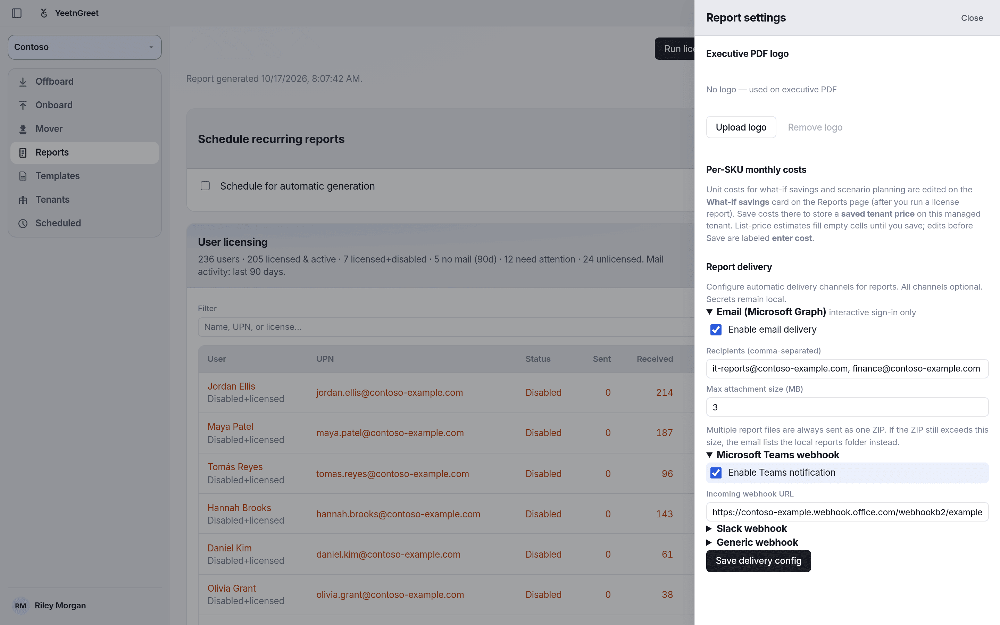

# Report delivery

Send license reports to the places your team already works: email, Teams, Slack, or your own automation.

Set it up in **Reports** → **Report settings** → **Report delivery**. Delivery settings are saved per tenant, and every channel is optional.

{ width="720" }
*Turn on the channels you want, then click Save delivery config.*

## Channels

| Channel | What it does |
| --- | --- |
| **Email (Microsoft Graph)** | Sends the report files to the recipients you list. Needs an interactive sign-in. Not available in app-only mode. |
| **Microsoft Teams webhook** | Posts a notification to a Teams channel through an incoming webhook URL. |
| **Slack webhook** | Posts a notification to Slack through an incoming webhook URL. |
| **Generic webhook** | Sends a JSON payload to your HTTPS endpoint: `{tenant, reportType, timestamp, status, files}`. |

Email sends several files as one ZIP. If the ZIP is bigger than the **Max attachment size** (3 MB by default, up to 10 MB), the email lists the local reports folder instead of attaching the files.

## Setup

1. Create the destination: a mailbox or distribution list, a Teams incoming webhook, a Slack incoming webhook, or an HTTPS listener.
2. Open **Reports** → **Report settings**, expand the channel, tick **Enable**, and paste the address or URL.
3. Click **Save delivery config**.
4. Run a report once to check that it arrives, then add it to a [schedule](../jobs/schedules.md).

!!! important "Keep webhook URLs private"
    Delivery settings stay on this PC. Anyone with a webhook URL can post to that channel, so store it like a password.

!!! note "What-if exports are never delivered"
    [What-if](what-if.md) scenario exports are saved on this PC only. They are never emailed or posted, even when delivery is set up.

To see what gets delivered, download the [sample reports](samples.md).

## Related

- [Reports overview](overview.md)
- [Schedules](../jobs/schedules.md)
- [Sample reports](samples.md)
