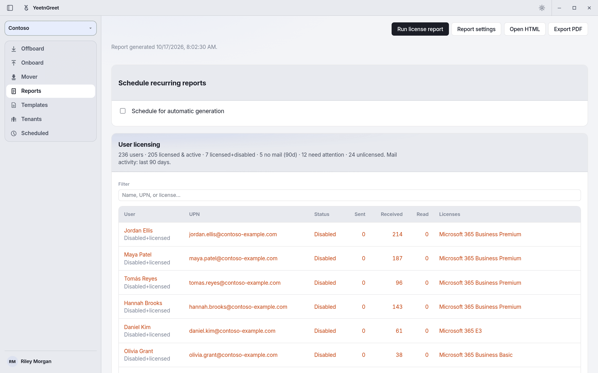

# License audit

See which Microsoft 365 licenses are assigned — with SKU detail, mail activity (last 90 days), and attention rows for **disabled + licensed** and **no mail** users.

In the app this is the **User licensing** card on **Reports** after you run a license report.

## When to use it

- Quarterly license hygiene
- Before a renewal or true-up
- After a merger / tenant consolidation wave
- Finding named users to reclaim before you cut prepaid licenses

## Steps

1. Select the tenant and sign in
2. Open **Reports** → **Run license report**
3. Review the **User licensing** summary and table (filter by name, UPN, or license)
4. Pair with [What-if](what-if.md) for priced reclaim and scenario planning
5. Export or [deliver](delivery.md) as needed

{ width="720" }
*The User licensing card lists the people who need attention, with their mail activity and licenses.*

To see the exported report, download the [sample license health report](samples.md#license-health-report) (PDF, HTML, and CSV, made with fictional data).

!!! tip "Plans"
    Free includes a limited license-report **preview**. Full named-user audit, exact savings, and exports are on paid plans. See [Pricing and licensing](../pricing-and-licensing.md).

!!! note "Mail activity"
    No-mail detection needs `Reports.Read.All`. If mail metrics are missing, re-sign in to grant the permission — the app will not treat every licensed user as inactive when mail data did not load.

## Related

- [Unused licenses](unused-licenses.md)
- [What-if](what-if.md)
- [Sample reports](samples.md)
