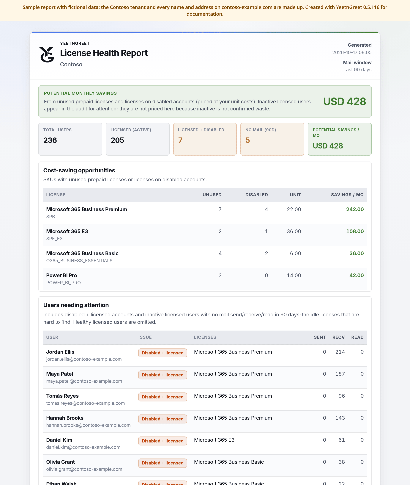
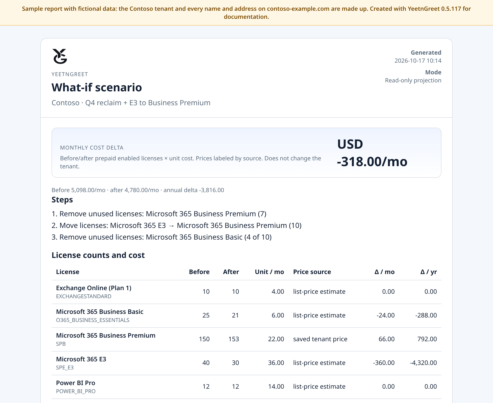

# Sample reports

These are real YeetnGreet exports, made with the app's own report templates from a **fictional** tenant. Download them to see exactly what you get. Your tenant names, licenses, and counts will differ.

!!! note "Sample data only"
    Contoso, every person, and every address on `contoso-example.com` are made up. Each file carries a "Sample" label. The figures are a demo, not a promise of savings. Always check in your tenant before you remove licenses.

## License health report

The report you get from **Reports** → **Run license report**. It shows potential monthly savings, the license counts that matter, cost-saving opportunities for each license, and the named users who need attention.

{ width="720" }
*Sample license health report: $428 a month in unused licenses and licenses on disabled accounts.*

Download the sample:

- [License health report (PDF)](../assets/samples/yeetngreet-sample-license-report.pdf)
- [License health report (HTML)](../assets/samples/yeetngreet-sample-license-report.html)
- [Unused licenses (CSV)](../assets/samples/yeetngreet-sample-license-report-unused.csv): one row per license with unused and disabled counts and the monthly savings
- [Users needing attention (CSV)](../assets/samples/yeetngreet-sample-license-report-audit.csv): disabled but still licensed, or no mail in 90 days

What to look for:

- **Potential savings** counts unused licenses and licenses on disabled accounts, times your unit price.
- **No mail (90d)** users are listed for review but not counted in savings, because inactive doesn't always mean the license isn't needed.

## What-if scenario export

What you get when you click **Export** or **Export PDF** in the [What-if](what-if.md) scenario planner. This sample is the three-step plan from the What-if page: remove 7 unused Business Premium, move 10 people from E3 to Business Premium, and remove unused Business Basic (4 of the 10 asked for were unused).

{ width="720" }
*Sample What-if export: −$318 a month (−$3,816 a year), and nothing changes in the tenant.*

Download the sample:

- [What-if scenario (PDF)](../assets/samples/yeetngreet-sample-whatif-scenario.pdf)
- [What-if scenario (HTML)](../assets/samples/yeetngreet-sample-whatif-scenario.html)
- [What-if scenario (CSV)](../assets/samples/yeetngreet-sample-whatif-scenario.csv): before and after counts and the monthly and yearly cost change for each license

The step list, the counts, and the costs all use what actually applied, so the export matches what you saw in the app. When a step was capped, the step shows both numbers, such as **4 of 10**. A step that couldn't apply is marked as skipped, with the reason.

Scenario exports are saved on this PC only, in `Documents\YeetnGreet\reports`. They are never emailed or posted, and license assignments in the tenant stay the same.

## Related

- [License audit](license-audit.md)
- [Unused licenses](unused-licenses.md)
- [What-if](what-if.md)
- [Report delivery](delivery.md)
