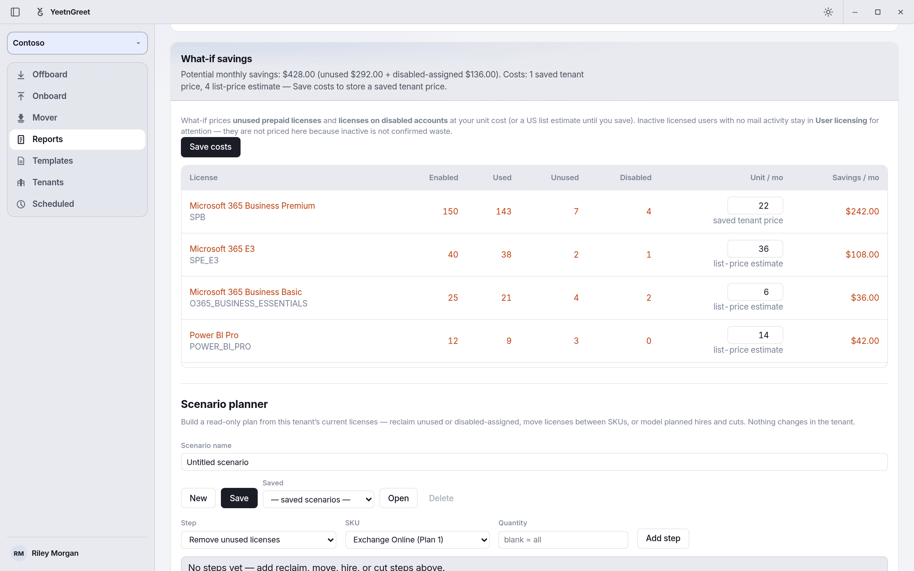
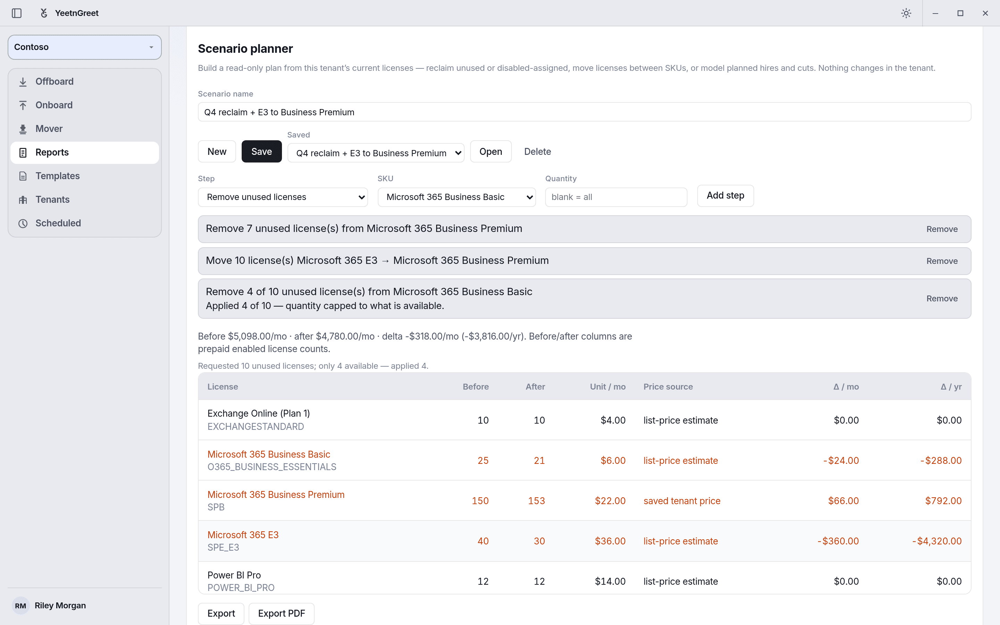
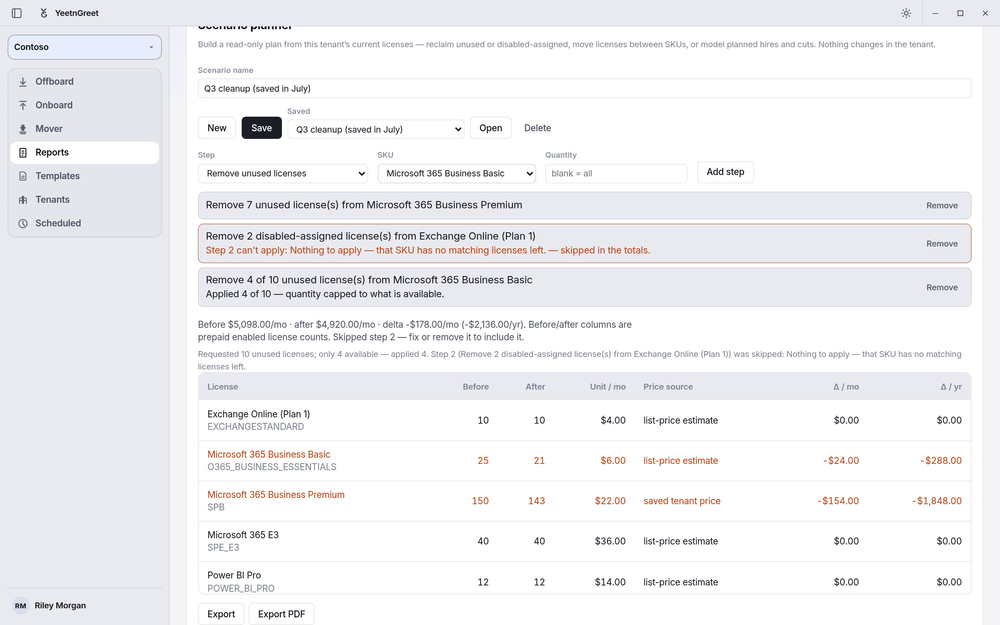

# What-if

Plan license changes before you make them in the admin center. What-if is on the **Reports** page, below **User licensing**, after you run a license report. It's read-only: nothing in the tenant changes.

The **What-if savings** card has two parts:

1. **Reclaim savings.** What you could save on unused licenses and licenses still assigned to disabled accounts.
2. **Scenario planner.** A named plan of steps with before and after license counts and the cost change.

## Reclaim savings

For each license, the table shows **Enabled**, **Used**, **Unused**, **Disabled**, the **Unit / mo** price, and **Savings / mo**.

- **Unused** is licenses you pay for that nobody has.
- **Disabled** is licenses still assigned to people whose sign-in is blocked.
- **Savings / mo** is what those unused and disabled licenses cost each month.

{ width="720" }
*Reclaim savings: $428 a month across unused and disabled licenses.*

Inactive licensed users (no mail activity in 90 days) are listed under **User licensing** for review. They aren't counted in the savings, because inactive doesn't always mean the license isn't needed.

## Unit prices

Microsoft Graph doesn't report what you pay, so each license shows a price and where it came from:

| Price source | Meaning |
| --- | --- |
| **list-price estimate** | US list price. Used until you enter your own. |
| **enter cost** | A price you typed but haven't saved yet. |
| **saved tenant price** | A price you saved for this tenant with **Save costs**. |

To use your own prices, type them in the **Unit / mo** column and click **Save costs**.

- **Only prices you type are saved.** List-price estimates are never saved as your price.
- **$0 and blank are different.** Type `0` for a license you get free, and it's saved as $0. Leave the box blank to use the list-price estimate. Clearing a saved price and saving again removes it.
- If a license has no price at all, totals count it as $0 and the planner shows a warning.

Always check prices against your Microsoft bill before you make a decision.

## Scenario planner

1. Type a **Scenario name**, for example "Q4 reclaim + E3 to Business Premium".
2. Pick a **Step** and a **SKU**, enter a **Quantity**, and click **Add step**. Repeat for each change.
3. Read the before and after counts and the monthly and yearly change.
4. Click **Save** to keep the scenario for this tenant.

| Step | What it does | Quantity |
| --- | --- | --- |
| **Remove unused licenses** | Stops paying for licenses nobody has | Blank = all unused on that SKU |
| **Remove disabled-assigned licenses** | Removes licenses from disabled accounts and stops paying for them | Blank = all on that SKU |
| **Move licenses (SKU → SKU)** | Moves people from one license to another, such as E3 to Business Premium. **To** can be a license the tenant doesn't have yet. | Required |
| **Add licenses (planned hires)** | Adds licenses for new people | Required |
| **Remove licenses (planned cuts)** | Removes licenses for planned reductions | Required |

{ width="720" }
*A three-step scenario. The last step asked for 10 but only 4 were unused, so 4 were applied.*

### How the cost is worked out

Each license's monthly cost is the number of licenses you pay for times its monthly unit price. The planner compares that before and after your steps.

Example: Business Premium at $22 and E3 at $36. The plan removes 5 unused Business Premium licenses, then moves 10 people from E3 to Business Premium. Before and after are license counts.

| SKU | Before | After | Monthly change |
| --- | ---: | ---: | ---: |
| Business Premium | 50 | 55 | +$110 |
| E3 | 20 | 10 | −$360 |

**Total: −$250 a month (−$3,000 a year).**

### When a step can't fully apply

- **Capped step.** If you ask for more than exist, the step applies what's available and says so, for example "Applied 4 of 10 — quantity capped to what is available."
- **Skipped step.** If a step can't apply at all, it's shown in red with its step number and the reason, for example "Step 2 can't apply: Nothing to apply — that SKU has no matching licenses left." This usually happens when you open a scenario saved before a newer report. The totals leave that step out until you fix or remove it.
- **New steps are checked first.** If a step you're adding can't apply, it isn't added, and the status bar says why.

{ width="720" }
*A skipped step is named, and the totals leave it out until you fix or remove it.*

### Save, open, and delete

- **Save** stores the scenario for the selected tenant on this PC.
- Pick a scenario under **Saved** and click **Open** to load it. Its steps are recalculated against the latest report.
- **Delete** removes the selected saved scenario. You're asked to confirm first.
- **New** starts an empty scenario.

### Export

- **Export** saves an HTML report and a CSV. **Export PDF** also saves a PDF.
- Files go to `Documents\YeetnGreet\reports` on this PC, and the HTML report opens in your browser.
- Exporting never emails or posts the scenario, even if the tenant has [report delivery](delivery.md) set up. Share the files yourself.
- The export lists each step with the quantity that applied. A capped step shows both numbers, such as **4 of 10**.
- Fix or remove any skipped step before you export.
- See a [sample What-if export](samples.md#what-if-scenario-export) (PDF, HTML, and CSV).

!!! tip "Name scenarios clearly"
    A name like "Q4 reclaim + E3 to Business Premium" makes it easy for the next person to find and reuse.

## Steps

1. Select the tenant and sign in on **Tenants**.
2. Open **Reports** and click **Run license report**.
3. In **What-if savings**, check the unit prices, type your own where you have them, and click **Save costs**.
4. In **Scenario planner**, add steps, review the totals, and click **Save**.
5. Optionally click **Export** or **Export PDF**.

The Free plan shows a savings range without per-license prices, named users, or scenario export.

## Related

- [Unused licenses](unused-licenses.md): how unused and disabled licenses are found
- [License audit](license-audit.md): licensed users who need attention
- [Sample reports](samples.md): download example exports
- [Pricing and licensing](../pricing-and-licensing.md)
