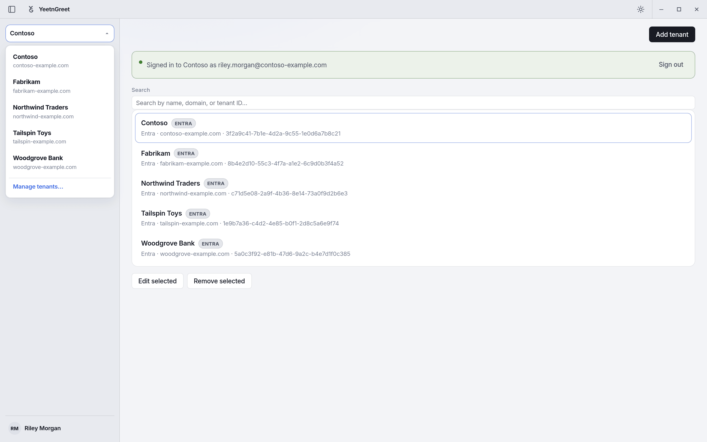

# Multi-tenant

Switch between the Microsoft 365 tenants on your account without mixing up context — as long as you confirm the active tenant before Live work. Licensed users are pooled across all tenants on the account for billing.

## Switching tenants

1. Open the tenant switcher in YeetnGreet
2. Select the tenant you are about to work on
3. Confirm domain / display name matches the ticket
4. Continue with onboard, offboard, or reports

{ width="720" }
*The tenant switcher in the left rail. Every job and report runs against the tenant shown here.*

!!! danger "Wrong-tenant rule"
    Preview and type-to-confirm protect actions, but they do not fix picking the wrong organization. Habit: read the tenant name before every confirm.

## Plan limits

| Plan | Managed tenants |
| --- | --- |
| Free | 1 |
| Paid plans (Starter and above) | Multiple tenants; licensed users pooled across the account |

See [Pricing and licensing](../pricing-and-licensing.md) for licensed-user bands and prices.

## Related

- [Hybrid AD](hybrid-ad.md)
- [First run](../getting-started/first-run.md)
